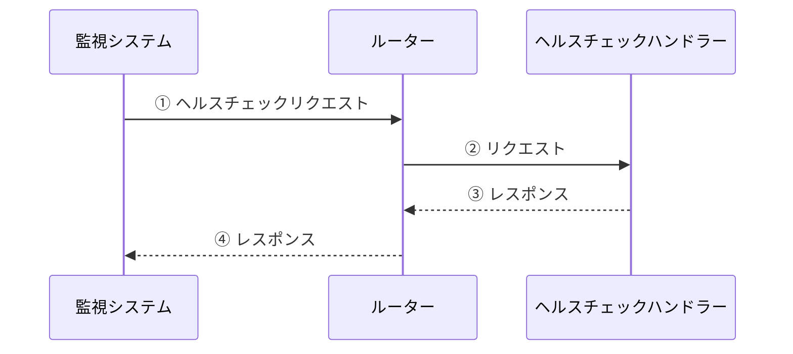

# ヘルスチェック 設計書

## 1. 概要

### 1.1. 目的

本設計書は、ヘルスチェック機能の内部処理および実装方針を定義する.

### 1.2. 関連ドキュメント

| ドキュメント | 内容 |
| ----- | ----- |
| [ヘルスチェック 機能仕様書](../specs/health-check.md) | 機能要件および非機能要件 |
| [API仕様書（SwaggerUI）](https://atsumarukun.github.io/holos-permit-api/) | エンドポイント、リクエスト、レスポンスの定義 |

## 2. 処理設計

### 2.1. 処理概要

ヘルスチェックエンドポイントへのリクエストを受け付け、APIサーバーから正常なレスポンスを返却する.

**シーケンス図**

### 2.2. ハンドラー処理

ヘルスチェックハンドラーでは、以下の処理を行う.

1. リクエストを受け付ける
2. HTTPステータスコード `204 No Content` を返却する

### 2.3.  認証処理

ヘルスチェックエンドポイントは認証対象外とし、認証ミドルウェアの呼び出しは行わない.

Ginのルーティンググループを利用し、認証ミドルウェアが適用されていないヘルスチェック専用のグループにヘルスチェックエンドポイントを登録する.

## 3. 実装上の制約

- ヘルスチェックハンドラーでは、データベースや外部サービスへのアクセスを行わない
- ヘルスチェックハンドラーでは、業務ロジックを実行しない
- ヘルスチェックハンドラーでは、応答性能を確保するため、不要な処理を実行しない
- ヘルスチェックレスポンスには、内部構成や機密情報を含めない
- ヘルスチェックによってデータの変更や副作用を発生させない
- API仕様書で定義されたインターフェースに従って実装する

---

**最終更新日**: 2026/11/16
