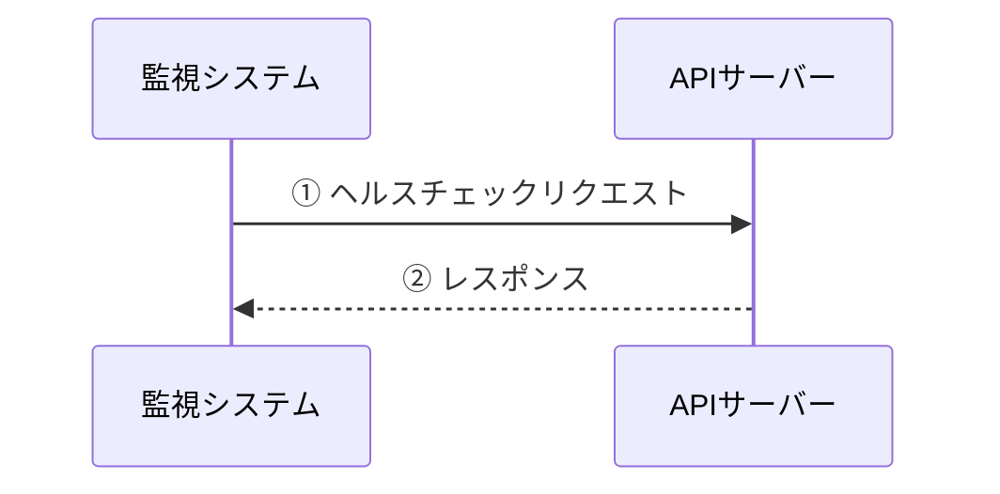

# ヘルスチェック 機能仕様書

## 1. 概要

### 1.1. 目的

本機能は、APIサーバーの稼働状態を確認するための機能を提供する.

外部の監視システムなどから定期的にヘルスチェックエンドポイントへリクエストを送信することで、サービスの障害を早期に検知できるようにする.

### 1.2. 機能概要

ヘルスチェックエンドポイントへのリクエストを受け付け、APIサーバーが正常に応答できることを確認する.

なお、本機能ではデータベースなどの依存サービスへの接続確認や業務処理は行わない.

### 1.3. 除外項目

以下は本機能の対象外とする.

- データベースなどの依存サービスの稼働状態確認
- 障害発生時の自動復旧処理
- 障害原因の詳細な分析
- システム全体のパフォーマンス監視
- 業務機能ごとの動作確認

## 2. 機能仕様

### 2.1. 処理概要

### 2.2. 正常判定条件

APIサーバーがヘルスチェックリクエストを受け付け、正常にレスポンスを返却できる場合、正常と判定する.

### 2.3. 異常判定条件

監視システム側で、以下のいずれかに該当する場合、異常と判定する.

- APIサーバーに接続できない
- APIサーバーから正常なレスポンスを受信できない
- リクエストがタイムアウトした

## 3. 非機能要件

### 3.1. 応答性能

ヘルスチェックリクエストの受信からレスポンスの返却までのAPIサーバー内部の処理時間は、通常時において100ms以内とする.

### 3.2. セキュリティ

以下のセキュリティ要件を満たすこと.

- 認証なしでヘルスチェックを実行できること
- 内部構成や機密情報を外部に公開しないこと
- ヘルスチェックによってデータの変更や副作用が発生しないこと

## 4. 運用要件

以下の運用要件を満たすこと.

- 外部の監視システムなどから定期的にヘルスチェックを実行できること
- 異常が検出された場合、監視システム側で障害として検知できること

---

**最終更新日**: 2026/11/16
