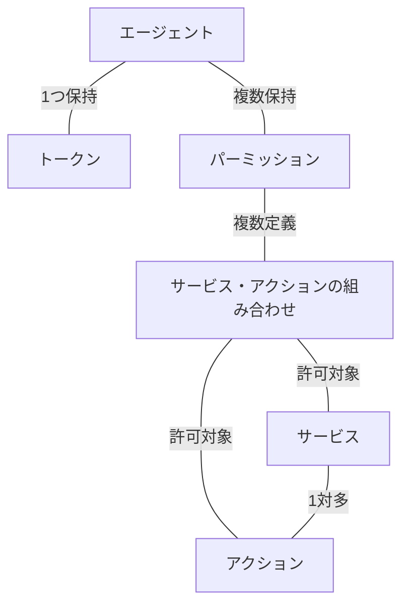
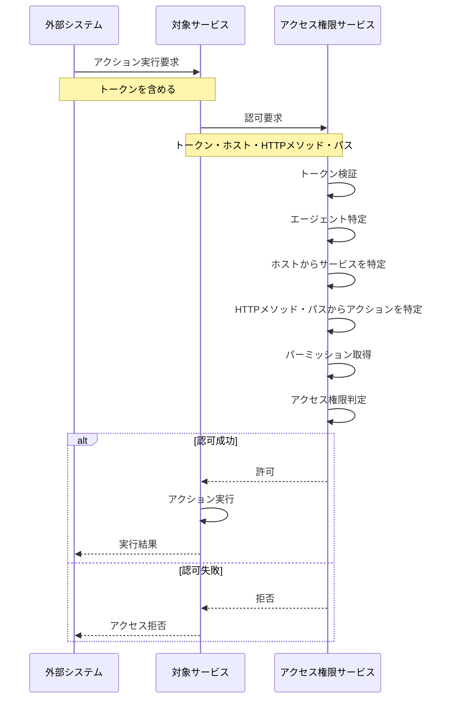

# 概要仕様書

## 1. 概要

### 1.1. 目的

本サービスは、外部システムからプロジェクト内の各サービスに対するアクセス権限を一元管理し、外部システムからの不正なアクセスを防止することを目的とする.

### 1.2. 概要

アクセス権限サービスは、外部システムからプロジェクト内のサービスに対するリクエストを受け付ける際に、実行主体のアクセス権限を判定するサービスである.

外部システムは、エージェントに紐づくトークンを使用してプロジェクト内のサービスにリクエストを行う. 各サービスは、リクエストの実行前にアクセス権限サービスへ認可を要求し、対象のサービスおよびアクションに対するアクセス権限が付与されているかを確認する.

アクセス権限サービスでは、パーミッション、エージェントおよびトークンを使用してアクセス権限を管理する.

### 1.3. 除外項目

以下は本仕様書の対象外とする.

- 各機能の機能仕様
- アカウントによるアクセスの権限管理

## 2. システム構成

### 2.1. 構成要素

アクセス権限サービスは、以下の構成要素からなる.

| 構成要素 | 役割 |
| ----- | ----- |
| パーミッション | アクセスを許可するサービス及びアクションを定義する |
| エージェント | パーミッションを保持し、外部システムからのアクセス主体となる |
| トークン | エージェントを識別するための認証情報 |
| 認可機能 | トークンからエージェントを特定し、要求されたアクションの実行権限を確認する |

### 2.2. 構成要素の関係

各構成要素は以下の関係を持つ.

- 1つのパーミッションは複数のサービスとアクションの組み合わせに対するアクセス権限を定義できる
- 1つのエージェントは複数のパーミッションを保持できる
- 1つのエージェントが保持できるトークンは1つ
- 1つのトークンは1つのエージェントに紐づく
- 1つのサービスは、複数のアクションを保持できる
- 1つのアクションは、必ず1つのサービスに所属する
- サービスにはホスト、アクションにはHTTPメソッドおよびパスが紐づく
- エージェントが保持するパーミッションに基づいて認可判定を行う

### 2.3. 構成要素の関連図

## 3. アクセス権限モデル

### 3.1. 基本方針

アクセス権限は、サービスとアクションの組み合わせによって定義する.

パーミッションは、アクセスを許可するサービスおよびアクションの集合を表す.

エージェントは、保持するパーミッションによって、各サービスおよびアクションに対するアクセス権限を持つ.

### 3.2. パーミッションの定義

パーミッションは、アクセスを許可するサービスとアクションの組み合わせを複数定義できる.

認可判定では、要求されたサービスとアクションの組み合わせが、パーミッションに定義されているかを確認する.

例として、以下のようなパーミッションを定義できる.

| サービス | アクション |
| ----- | ----- |
| storage | createEntry |
| permit | deleteAgent |

このパーミッションを保持するエージェントは、上記のサービスおよびアクションの組み合わせに対する実行権限を持つ.

### 3.3. 権限の集約

エージェントが複数のパーミッションを保持している場合、それぞれのパーミッションで許可された権限を統合して認可判定を行う.

同一のサービスおよびアクションが複数のパーミッションに定義されている場合でも、権限は重複して付与されないものとする.

### 3.4. 権限の判定原則

認可判定は、要求されたサービスおよびアクションが、エージェントの保持するいずれかのパーミッションに定義されているかによって判断する.

明示的に許可されていないサービスおよびアクションへのアクセスは拒否する.

## 4. 認証・認可方式

### 4.1. 基本方針

外部システムは、エージェントに紐づくトークンを使用してプロジェクト内のサービスにリクエストを行う.

各サービスは、リクエストの実行前にアクセス権限サービスへ認可を要求する.

アクセス権限サービスは、トークンの有効性を検証し、紐づくエージェントを特定したうえで、要求されたサービスおよびアクションに対するアクセス権限を確認する.

認可が成功した場合のみ、各サービスは対象アクションを実行する.

### 4.2. 認可要求

各サービスは、アクセス権限サービスに対して以下の情報を使用して認可を要求する.

| 項目 | 説明 |
| ----- | ----- |
| トークン | リクエストの実行主体を識別するためのトークン |
| ホスト | 対象サービスを特定するためのホスト |
| HTTPメソッド | 対象アクションを特定するためのHTTPメソッド |
| パス | 対象アクションを特定するためのパス |

### 4.3. 認可処理

認可処理は、以下の手順で実施する.

1. 対象サービスからトークン、ホスト、HTTPメソッドおよびパスを受け取る
2. トークンの有効性を検証する
3. トークンに紐づくエージェントを特定する
4. 受け取ったホストから対象サービスを特定する
5. 受け取ったHTTPメソッド及びパスから対象アクションを特定する
6. エージェントに割り当てられたパーミッションを取得する
7. 特定したサービスおよびアクションが許可されているか確認する
8. 認可結果を対象サービスへ返却する

### 4.4. 認可フロー

### 4.5. 認可判定条件

以下のすべての条件を満たす場合、認可を許可する.

- トークンが有効である
- トークンに紐づくエージェントが存在する
- ホストから対象サービスを特定できる
- HTTPメソッドおよびパスから対象アクションを特定できる
- エージェントが保持するいずれかのパーミッションに、特定したサービスおよびアクションの組み合わせが定義されている

上記の条件を満たさない場合、認可を拒否する.

## 5. 権限変更の反映

### 5.1. パーミッション変更

パーミッションの追加、更新および削除は、当該パーミッションを保持するエージェントの認可結果に反映する.

### 5.2. エージェント変更

エージェントが保持するパーミッションの追加および削除は、当該エージェントに紐づくトークンを使用した認可処理に反映する.

### 5.3. トークン削除

削除されたトークンは無効とし、当該トークンを使用した認可要求は拒否する.

---

**最終更新日**: 2026/11/23
