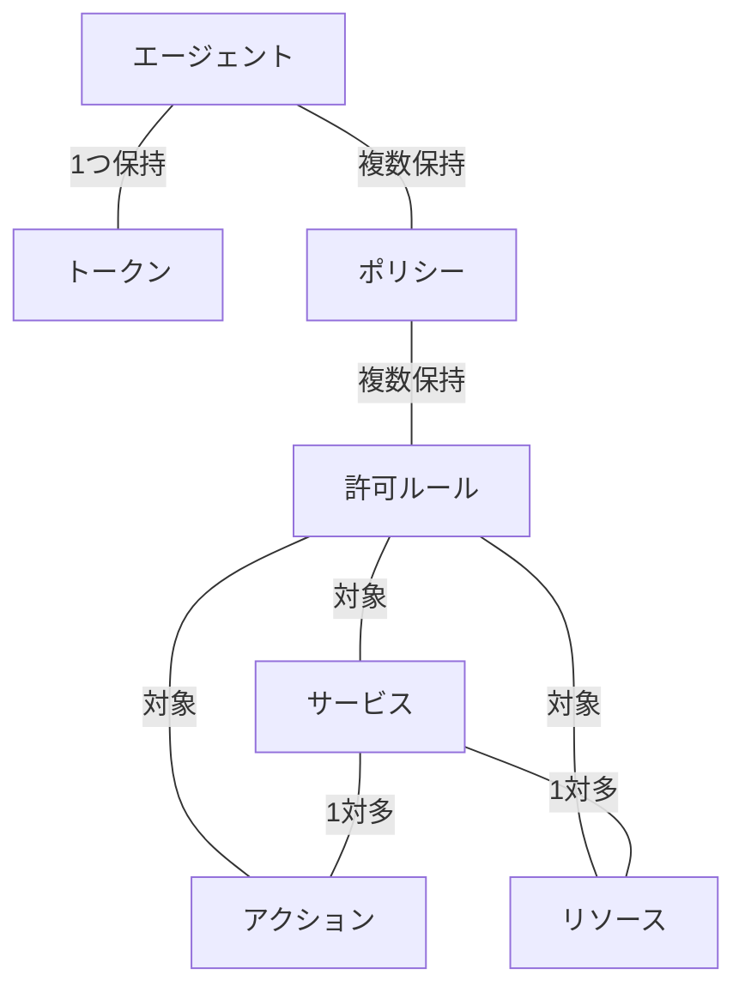
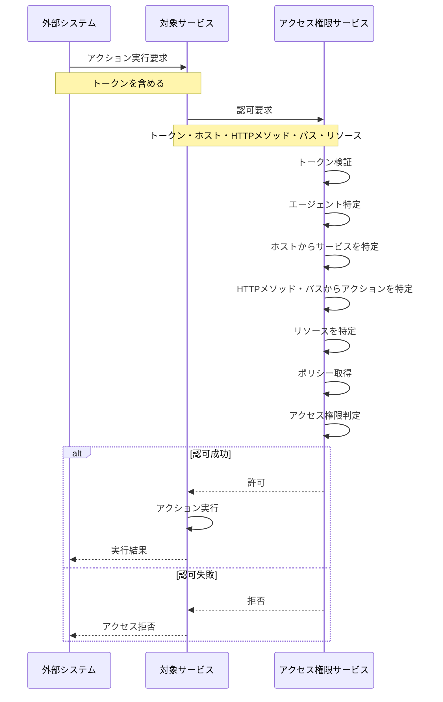

# 概要仕様書

## 1. 概要

### 1.1. 目的

本サービスは、外部システムからプロジェクト内の各サービスに対するアクセス権限を一元管理し、外部システムからの不正なアクセスを防止することを目的とする.

### 1.2. 概要

アクセス権限サービスは、外部システムからプロジェクト内のサービスに対するリクエストを受け付ける際に、実行主体のアクセス権限を判定するサービスである.

外部システムは、エージェントに紐づくトークンを使用してプロジェクト内のサービスにリクエストを行う. 各サービスは、リクエストの実行前にアクセス権限サービスへ認可を要求し、対象のサービス、アクション及びリソースに対するアクセス権限が付与されているかを確認する.

アクセス権限サービスでは、ポリシー、エージェント及びトークンを使用してアクセス権限を管理する.

### 1.3. 除外項目

以下は本仕様書の対象外とする.

- 各機能の機能仕様
- アカウントによるアクセスの権限管理

## 2. システム構成

### 2.1. 構成要素

アクセス権限サービスは、以下の構成要素からなる.

| 構成要素 | 役割 |
| ----- | ----- |
| ポリシー | アクセスを許可するサービス、アクション及びリソースの組み合わせを定義する |
| エージェント | ポリシーを保持し、外部システムからのアクセス主体となる |
| トークン | エージェントを識別するための認証情報 |
| 認可機能 | トークンからエージェントを特定し、要求されたサービス、アクション及びリソースに対する実行権限を確認する |

### 2.2. 構成要素の関係

各構成要素は以下の関係を持つ.

- 1つのポリシーは複数のサービス、アクション及びリソースの組み合わせに対するアクセス権限を定義できる
- 1つのエージェントは複数のポリシーを保持できる
- 1つのエージェントが保持できるトークンは1つ
- 1つのトークンは1つのエージェントに紐づく
- 1つのサービスは、1つ以上のアクションを保持できる
- 1つのアクションは、必ず1つのサービスに所属する
- 1つのサービスは、0以上のリソースを保持できる
- 1つのリソースは、必ず1つのサービスに所属する
- サービスにはホスト、アクションにはHTTPメソッド及びパスが紐づく
- エージェントが保持するポリシーに基づいて認可判定を行う

### 2.3. 構成要素の関連図

## 3. アクセス権限モデル

### 3.1. 基本方針

アクセス権限は、サービス、アクション及びリソースの組み合わせによって定義する.

ポリシーは、アクセスを許可するサービス、アクション及びリソースの組み合わせの集合を表す.

エージェントは、保持するポリシーによって、各サービス及びアクションを対象リソースに対して実行する権限を持つ.

### 3.2. ポリシーの定義

ポリシーは、アクセスを許可するサービス、アクション及びリソースの組み合わせを複数定義できる.

認可判定では、要求されたサービス、アクション及びリソースの組み合わせが、ポリシーに定義されているかを確認する.

例として、以下のようなポリシーを定義できる.

| サービス | アクション | リソース |
| ----- | ----- | ----- |
| storage | createEntry | volume:volume01 |
| permit | deleteAgent | agent:e3e36f5d-0ec0-4ac4-a6b5-97f49212a376 |

このポリシーを保持するエージェントは、以下の操作を実行する権限を持つ.

- storage サービスの volume:volume01 に対する createEntry アクション
- permit サービスの agent:e3e36f5d-0ec0-4ac4-a6b5-97f49212a376 に対する deleteAgent アクション

### 3.3. 権限の集約

エージェントが複数のポリシーを保持している場合、それぞれのポリシーで許可された権限を統合して認可判定を行う.

同一のサービス、アクション及びリソースの組み合わせが複数のポリシーに定義されている場合でも、権限は重複して付与されないものとする.

### 3.4. 権限の判定原則

認可判定は、要求されたサービス、アクション及びリソースの組み合わせが、エージェントの保持するいずれかのポリシーに定義されているかによって判断する.

明示的に許可されていないサービス、アクション及びリソースの組み合わせに対するアクセスは拒否する.

## 4. 認証・認可方式

### 4.1. 基本方針

外部システムは、エージェントに紐づくトークンを使用してプロジェクト内のサービスにリクエストを行う.

各サービスは、リクエストの実行前にアクセス権限サービスへ認可を要求する.

アクセス権限サービスは、トークンの有効性を検証し、紐づくエージェントを特定したうえで、要求されたサービス、アクション及びリソースに対するアクセス権限を確認する.

認可が成功した場合のみ、各サービスは対象アクションを実行する.

### 4.2. 認可要求

各サービスは、アクセス権限サービスに対して以下の情報を使用して認可を要求する.

| 項目 | 説明 |
| ----- | ----- |
| トークン | リクエストの実行主体を識別するためのトークン |
| ホスト | 対象サービスを特定するためのホスト |
| HTTPメソッド | 対象アクションを特定するためのHTTPメソッド |
| パス | 対象アクションを特定するためのパス |
| リソース | アクセス対象となるリソースを特定するための識別子 |

### 4.3. 認可処理

認可処理は、以下の手順で実施する.

1. 対象サービスからトークン、ホスト、HTTPメソッド、パス及びリソースを受け取る
2. トークンの有効性を検証する
3. トークンに紐づくエージェントを特定する
4. 受け取ったホストから対象サービスを特定する
5. 受け取ったHTTPメソッド及びパスから対象アクションを特定する
6. 受け取ったリソース情報から対象リソースを特定する
7. エージェントに割り当てられたポリシーを取得する
8. 特定したサービス、アクション及びリソースの組み合わせが許可されているか確認する
9. 認可結果を対象サービスへ返却する

### 4.4. 認可フロー

### 4.5. 認可判定条件

以下のすべての条件を満たす場合、認可を許可する.

- トークンが有効である
- トークンに紐づくエージェントが存在する
- ホストから対象サービスを特定できる
- HTTPメソッド及びパスから対象アクションを特定できる
- リソース情報から対象リソースを特定できる
- エージェントが保持するいずれかのポリシーに、特定したサービス、アクション及びリソースの組み合わせが定義されている

上記の条件を満たさない場合、認可を拒否する.

## 5. 権限変更の反映

### 5.1. ポリシー変更

ポリシーの追加、更新及び削除は、当該ポリシーを保持するエージェントの認可結果に反映する.

### 5.2. エージェント変更

エージェントが保持するポリシーの追加及び削除は、当該エージェントに紐づくトークンを使用した認可処理に反映する.

### 5.3. トークン削除

削除されたトークンは無効とし、当該トークンを使用した認可要求は拒否する.

---

**最終更新日**: 2026/11/28
